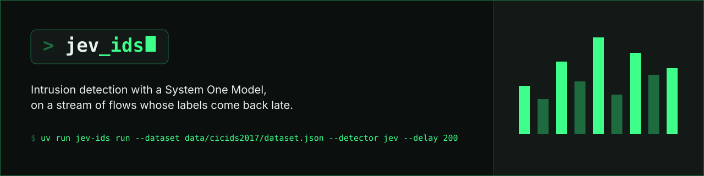
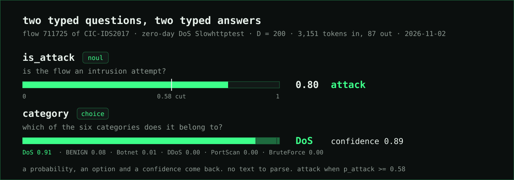
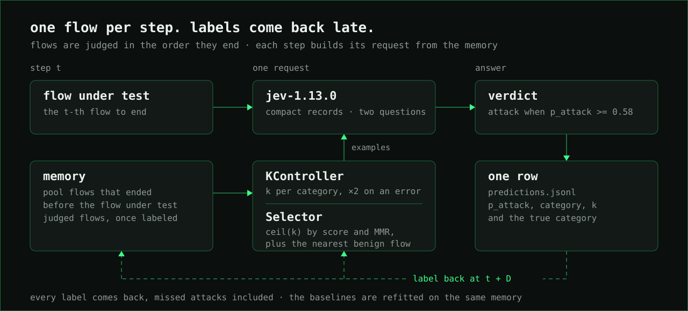
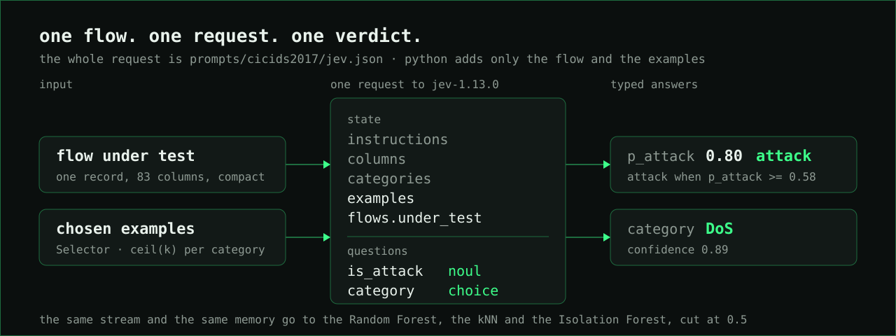
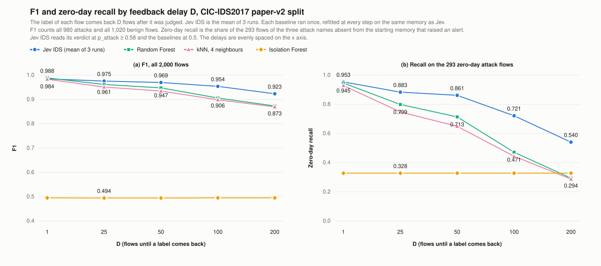

# Jev IDS

   

**Intrusion detection on a stream of network flows. For each flow, Jev IDS picks a few labeled flows from what it has already seen and shows them to [TypeSafe's Jev](https://docs.typesafe.ai/introduction) in one request. Jev answers whether the flow is an attack and which kind, in under a quarter of a second, with no text to parse.**

Jev IDS was tested on CIC-IDS2017, a reference benchmark of the cybersecurity community, against a classic machine-learning model (Random Forest), a nearest-neighbour model (kNN) and an unsupervised one (Isolation Forest). The 2,000 test flows arrive in the order they ended, and the label of each one comes back D flows later, the way an analyst's confirmation would. Three attack names never appear in the memory the detectors start from, so their 293 flows are zero-day attacks. The baselines are refitted after every flow on the same memory Jev sees. With labels coming back D flows late, Jev IDS:

- **Caught 54% of the zero-day attacks** at D = 200, where the Random Forest caught 29%.
- **Scored a higher F1 than every classical detector from D = 25 on**, in each of three runs, with 0.975 against the Random Forest's 0.961 at D = 25 and 0.923 against 0.873 at D = 200.
- **Raised 1 to 6 false alarms** on 1,020 benign flows at every D, where the Isolation Forest raised 75 to 77.
- **Cost $121 to $131 per million flows** at list price, with a median of 0.22 to 0.24 s per flow.

With every label back one flow later (D = 1), the Random Forest learns each attack from its first flows and scores slightly higher, 0.988 against 0.984, a difference the paired test does not confirm. The gap opens as D grows, because a delayed label reaches the forest only after most of a burst has passed, while Jev still judges the new attack from examples of the known ones. At D = 25 the flow-level sign test confirms the win on all flows in two of the three runs and on zero-day attacks in all three. From D = 50 on it confirms both in every run. The numbers, the ablations and their limits are in [Evidence and limits](#evidence-and-limits) and [docs/jevids-design.md](docs/jevids-design.md).

[Read the loop](jev_ids/stream.py) · [The request template](prompts/cicids2017/jev.json) · [Design log](docs/jevids-design.md) · [Glossary](CONTEXT.md)

## How it works

Jev is a System One Model. It reads a `state` and answers typed questions about it with probabilities. Jev IDS puts one flow into the state, next to the instructions, the column names, the six category descriptions and the labeled examples, and asks two questions. `is_attack` comes back as a probability. `category` comes back as one of six options with a confidence. The verdict is attack when the probability reaches 0.58, a cut taken on a separate validation stream before the test.



Around that request runs a loop over the stream. Flows are judged in the order they end, and each step builds the request from four parts.

1. **Memory.** The labeled flows a step may use are the pool flows that ended before the flow under test and the judged flows whose label has come back. A label comes back D steps after its flow, missed attacks included.
2. **KController.** It decides how many examples each category gets. Every category starts at k = 1. When a returned label shows that Jev named the wrong category, the k of the true category doubles, up to 8. When Jev named it right, that k falls by 1/k, never below 1. It is TCP's AIMD mirrored, because in an IDS the costly mistake is too few examples.
3. **Selector.** It decides which examples. Within each category of the memory, it ranks every candidate by similarity to the flow under test, by recency and by how unsure Jev was about it, then picks ceil(k) of them by maximal marginal relevance, so near-duplicates are left out. Last, it adds the benign flow nearest to the flow under test when the pick left it out, so Jev always sees the normal traffic closest to it.
4. **Compact record.** Every decimal value reaches Jev with 4 significant digits. Integers such as ports stay as they are and no column is removed, which saves 21% to 25% of the tokens with no loss in F1.



The whole request is one file, [`prompts/cicids2017/jev.json`](prompts/cicids2017/jev.json). Python adds only the flow and the examples, and the file's sha256 travels in every prediction row as `prompt_hash`, so runs that asked different things are never compared as equals. Examples are labeled by category only, and attack names such as `DoS Hulk` never reach a model.



The baselines see the same stream. The Random Forest and the kNN are refitted at every step on the whole memory, and the Isolation Forest on its benign flows alone, so each one judges a flow knowing exactly what Jev knows at that moment. They take their verdict at the usual 0.5.

## Try it

```bash
git clone https://github.com/jev-sec/jev-ids.git
cd jev-ids
uv sync
# .env holds TYPESAFE_API_KEY for Jev. Gemini needs `gcloud auth application-default login` and GOOGLE_GENAI_USE_VERTEXAI=true,
# GOOGLE_CLOUD_PROJECT and GOOGLE_CLOUD_LOCATION=global in the environment. DEEPSEEK_API_KEY and CHATGPT_CLIENT_ID serve the other LLMs.
```

Download `CICIDS2017_improved.zip` from the [relabelled version of Liu et al.](https://intrusion-detection.distrinet-research.be/CNS2022/Dataset_Download.html) into `data/raw/cicids2017/` and prepare it once. The committed splits need only the pool.

```bash
uv run python -m scripts.prepare_cicids2017
uv run jev-ids run --dataset data/cicids2017/dataset.json --detector jev --split smoke --delay 1 --k 1 --control aimd --selection score+nearest --seeds 0
```

The script drops the "Attempted" flows and the attacks with too few flows to measure (the web attacks, Heartbleed and the 36 flows labeled plain Infiltration), splits each attack's flows of each day in time between the pool and the test file, and holds three attack names out of the pool as zero-day attacks. Its docstring gives every decision and [`SOURCE.json`](data/cicids2017/splits/SOURCE.json) the counts.

The smoke split is five flows. The run writes `results/<timestamp>-cicids2017-jev-smoke/` with `config.json`, one JSON row per flow in `predictions.jsonl` (the verdict, the truth, p_attack, the category, the confidence, the k of every category, the latency and the gateway's token report) and the raw answers in `responses.jsonl`.

NSL-KDD has no timestamps, so it runs as a batch of k-shot requests with no stream. Download [NSL-KDD](https://www.kaggle.com/datasets/hassan06/nslkdd) into `data/raw/nsl-kdd/` and prepare it once.

```bash
uv run python -m scripts.prepare_nsl_kdd
uv run jev-ids run --dataset data/nsl-kdd/dataset.json --detector jev --split smoke --k 0,1
```

## Compare detectors

```bash
uv run jev-ids run --dataset data/cicids2017/dataset.json --split paper-v2 --delay 200 --detector jev --k 1 --control aimd --selection score+nearest --seeds 0,1,2
uv run jev-ids run --dataset data/cicids2017/dataset.json --split paper-v2 --delay 200 --detector random_forest --k all --seeds 0
uv run jev-ids run --dataset data/cicids2017/dataset.json --split paper-v2 --delay 200 --detector isolation_forest --k all --seeds 0
uv run jev-ids run --dataset data/cicids2017/dataset.json --split paper-v2 --delay 200 --detector knn --neighbours 4 --k all --seeds 0
uv run jev-ids metrics --threshold 0.58 results/<jev_run> > results/jev.csv
uv run jev-ids metrics results/<rf_run> results/<if_run> results/<knn_run> > results/baselines.csv
uv run jev-ids compare --a results/<jev_run> --b results/<rf_run> --k-a 1 --k-b all --threshold-a 0.58 --subset novel  # novel = zero-day attacks
```

`--delay` streams the split with every label coming back D flows late. `--control aimd` hands k to the KController, starting from `--k 1`, and `--selection score+nearest` runs the Selector with the nearest benign flow. `--record compact` is the default. `metrics` prints one CSV row per run with F1, precision, recall, recall on zero-day attacks (`novel` in the code) at their first flows and after their labels came back, recall per category, false alarms, PR-AUC and ROC-AUC of p_attack, tokens, latency and cost, and `--threshold 0.58` reads Jev's verdicts at its cut. `compare` pairs two runs flow by flow and runs McNemar's exact test on the discordant pairs, because only the flows two detectors disagree on tell them apart. Cost is computed offline as tokens times the list prices in [`prices.json`](prices.json), for every detector alike.

## Reproduce the paper

Each CIC-IDS2017 run of the paper is a `make` target over the `paper-v2` split. A finished run with no failed call leaves a stamp in `results/design-cicids2017/v2-done/`, so `make -k` runs again only what is missing, and a Jev chain and a baseline chain can run in two terminals at once.

```bash
make v2-cut                  # the full system over the validation stream, then `jev-ids threshold` on its run gives the cut
make -k v2-d1                # D = 1, the full system at seeds 0 to 2 and the four baselines
make -k v2-paper-jev         # the full system at D = 25, 50, 100 and 200, then the ablations
make -k v2-paper-baselines   # the four baselines at D = 25, 50, 100 and 200
make -k results/design-cicids2017/v2-done/full-d{25,50,100,200}-s{1,2}   # seeds 1 and 2 of the full system
make -k v2-d500              # D = 500, past the longest burst, as for D = 1
make -k results/design-cicids2017/v2-done/{full-d250-s0,rf-d250,if-d250,knn4-d250,knnmatched-d250}   # D = 250, seed 0 alone
```

[`docs/jevids-design.md`](docs/jevids-design.md) fixes the split, the cut and the metrics before the runs, logs every change made after a result was seen, and reads each run next to its stamp. The NSL-KDD benchmark runs with `make paper`, as [`docs/protocol.md`](docs/protocol.md) describes.

## Why it is fast and cheap

- **One request, two answers.** Both questions run over the same state and come back as a probability, an option and a confidence. Nothing to parse, no schema to enforce.
- **Input only.** Jev charges $0.042 per million input tokens and nothing for output. At 2,900 to 3,100 tokens per flow, a million verdicts cost $121 to $131.
- **Few examples, chosen well.** The KController keeps k at 1 wherever Jev is right, and the Selector picks examples close to the flow. Drawing the examples at random instead raised the false alarms to 58 to 69 per 1,020 benign flows, against 2 to 5.
- **Compact records.** Four significant digits save 21% to 25% of the tokens with no loss in F1.
- **The prompt is a file.** Its sha256 rides in every row, so runs with different prompts are never compared as equals.
- **Fail open.** A failed call becomes a row with `error`, counted as no alert. Never a crash.
- **Cut fixed before the test.** p_attack ≥ 0.58 decides for Jev, taken on a validation stream before the test, and 0.5, their usual cut, for the baselines. No tuning on the test flows.

## Small enough to read

| File                                                                   | Job                                                                                                         |
| ---------------------------------------------------------------------- | ----------------------------------------------------------------------------------------------------------- |
| [cli.py](jev_ids/cli.py)                                               | `run`, `redo-errors`, `metrics`, `compare`, `sign-test` and `threshold`                                     |
| [dataset.py](jev_ids/dataset.py)                                       | The card, the pool, the splits, the k-shot example draw and the compact record                              |
| [stream.py](jev_ids/stream.py)                                         | The stream, the memory and the labels that come back D flows late                                           |
| [controller.py](jev_ids/controller.py)                                 | The KController, k per category by mirrored AIMD                                                            |
| [selector.py](jev_ids/selector.py)                                     | The Selector, examples by score and MMR plus the nearest benign flow                                        |
| [run.py](jev_ids/run.py)                                               | The loop, cell by cell and flow by flow, and the three files of a run                                       |
| [records.py](jev_ids/records.py)                                       | One prediction row and its JSONL                                                                            |
| [metrics.py](jev_ids/metrics.py)                                       | F1, recall per category, PR-AUC, tokens, cost, latency, the paired tests                                    |
| [detectors/jev.py](jev_ids/detectors/jev.py)                           | Jev through TypeSafe's API, one flow per request                                                            |
| [detectors/random_forest.py](jev_ids/detectors/random_forest.py)       | The classical baseline                                                                                      |
| [detectors/knn.py](jev_ids/detectors/knn.py)                           | The nearest-neighbour baseline, in the Selector's distance                                                  |
| [detectors/isolation_forest.py](jev_ids/detectors/isolation_forest.py) | The unsupervised baseline, fitted on benign traffic alone                                                   |
| [detectors/llm.py](jev_ids/detectors/llm.py)                           | The LLM baselines through Agno, used on NSL-KDD                                                             |
| [prompts/](prompts)                                                    | One folder per dataset, with `jev.json`, the whole request template, and `llm.md`, the agent's instructions |
| [scripts/](scripts)                                                    | One `prepare_<dataset>.py` per dataset, and `draw_split.py` for the splits                                  |

## Evidence and limits

The `paper-v2` split of CIC-IDS2017 holds 2,000 flows in the order they ended, 1,020 benign and 980 attacks, 293 of those zero-day. It was drawn from rows no earlier split held and read once. The full system ran three times at each D, and every baseline once. The runs of 2026-11-02 are in [`results/design-cicids2017/`](results/design-cicids2017) and their reading in [`docs/jevids-design.md`](docs/jevids-design.md).

| D   | Jev IDS F1    | Random Forest F1 | kNN F1 | Isolation Forest F1 | Jev IDS zero-day recall | Random Forest zero-day recall | Jev IDS false alarms / 1,020 | Random Forest false alarms / 1,020 |
| --- | ------------- | ---------------- | ------ | ------------------- | ----------------------- | ----------------------------- | ---------------------------- | ---------------------------------- |
| 1   | 0.984 ± 0.001 | 0.988            | 0.983  | 0.495               | 0.953                   | 0.945                         | 1 to 2                       | 1                                  |
| 25  | 0.975 ± 0.002 | 0.961            | 0.951  | 0.494               | 0.883                   | 0.799                         | 2                            | 0                                  |
| 50  | 0.969 ± 0.001 | 0.947            | 0.934  | 0.494               | 0.861                   | 0.713                         | 3 to 6                       | 0                                  |
| 100 | 0.954 ± 0.004 | 0.906            | 0.898  | 0.495               | 0.721                   | 0.471                         | 2 to 4                       | 0                                  |
| 200 | 0.923 ± 0.001 | 0.873            | 0.869  | 0.495               | 0.540                   | 0.294                         | 3                            | 0                                  |

Jev IDS is the mean and standard deviation of three runs, and its false alarms the range over them. The kNN uses 4 neighbours. Flow by flow, with Holm's correction over all flows, known attacks and zero-day attacks, Jev IDS beats the Random Forest on zero-day attacks in every run from D = 25 on (adjusted p ≤ 0.042) and on all flows in every run from D = 50 on (adjusted p ≤ 0.0014). At D = 25 the win on all flows holds in two runs of three (adjusted p = 0.0055 and 0.027, against 0.056). At D = 1 no run differs from the forest on all flows, and in one run the forest is better on known attacks (16 flows against 4, adjusted p = 0.035). The Random Forest raises almost no false alarm, so its losses are attacks it lets through. At D = 200 it misses every flow of `SSH-Patator` and `Infiltration - Portscan`, where the first run of Jev IDS catches 62 of 87 and 28 of 89. The Isolation Forest catches only `DoS Slowhttptest` among the zero-day attacks, 96 of its 117 flows, and the same 35% of all attacks at every D. D = 250 and 500 add nothing past D = 200 (F1 0.929 and 0.920 for the first run of Jev IDS, 0.872 and 0.873 for the forest).



Each component was removed in turn, one run each at D = 1, 50 and 200.

| Line              | What changes                               | F1 at D = 1 / 50 / 200 | False alarms | Tokens per flow       |
| ----------------- | ------------------------------------------ | ---------------------- | ------------ | --------------------- |
| Full system       | nothing                                    | 0.985 / 0.970 / 0.925  | 2 / 5 / 3    | 3,029 / 2,984 / 3,096 |
| No Selector       | examples drawn at random from the memory   | 0.925 / 0.935 / 0.886  | 69 / 65 / 58 | 3,510 / 3,490 / 3,692 |
| Fixed k = 1       | no KController, one example per category   | 0.978 / 0.962 / 0.916  | 3 / 3 / 4    | 2,848 / 2,841 / 2,816 |
| Fixed k = 4       | no KController, four examples per category | 0.990 / 0.978 / 0.928  | 6 / 6 / 8    | 6,033 / 6,021 / 5,899 |
| Full record       | values as the CSV has them                 | 0.982 / 0.972 / 0.923  | 2 / 3 / 3    | 3,846 / 3,843 / 4,120 |
| Random, k = 4     | no Selector, no KController                | 0.957 / 0.955 / 0.927  | 75 / 73 / 69 | 5,410 / 5,388 / 5,322 |
| No nearest benign | the Selector without its benign anchor     | 0.979 / 0.971 / 0.929  | 27 / 29 / 22 | 3,300 / 3,339 / 3,351 |

Without the Selector, Jev IDS loses on all flows at every D (adjusted p ≤ 8.7e-6). With one example per category it loses on all flows at D = 1 (adjusted p = 0.007) and ties at D = 50 and 200, so the KController buys 0.7 to 0.8 points of F1 for 5% to 10% more tokens. Four examples per category tie with the full system at every D for twice the tokens. The full record ties at every D with 21% to 25% more tokens. Random examples lose at D = 1 and 50 and raise 69 to 75 false alarms. The nearest benign flow cuts the false alarms from 22 to 29 down to 2 to 5 and costs some zero-day flows at first contact.

Limits worth knowing:

- One dataset carries the stream results. NSL-KDD has no timestamps, so it was measured as a k-shot benchmark only (below).
- The delays were chosen from the bursts of this same split. Each zero-day attack arrives as one burst of 116 to 171 flows, so D = 25 to 100 return labels while a burst lasts and D = 200 returns none before it ends.
- The cut of 0.58 sits on a thin margin. On the validation stream, the highest benign p_attack was 0.55 and the lowest attack p_attack 0.58.
- Every label comes back, missed attacks included. A real SOC confirms only some of them.
- The ablations ran once each. The full system's F1 varies by up to 0.009 between runs at one D, so a smaller gap between two lines may come from the run alone.
- Jev's latency is the wall clock of one successful call to TypeSafe's API and leaves out the Selector's own time. Jev's cost is TypeSafe's list price, not what was billed.
- Jev's `noul` answer carries no confidence. Only the `choice` answer does.

## Earlier benchmark: NSL-KDD

Before the stream, Jev IDS was measured on NSL-KDD as a k-shot detector, with k labeled examples per category drawn at random and no feedback, against Gemini 3.6 Flash on Vertex AI, a Random Forest and an Isolation Forest (2,000 flows, three seeds, runs of 2026-09-22). At k = 1 Jev was 5.4 times faster than the LLM, with a median of 0.31 s against 1.65 s per flow, and 22 times cheaper, with $74 against $1,651 per million flows. It was as precise (0.953 against 0.942) and lower on F1 (0.856 against 0.880). On zero-day attacks it caught 74.7% against 71.3%, a difference the paired test confirms only at k = 1 and 2. The tables, figures and tests are in [docs/results.md](docs/results.md) and the protocol in [docs/protocol.md](docs/protocol.md).

## Development

```bash
make check
```

Python 3.13+. The gate runs ruff with Google-style docstring rules, complexipy, pyright in strict mode, pytest with coverage, vulture, pip-audit and jscpd. Thresholds live in `pyproject.toml` and `.jscpd.json`. Runs make paid API calls and write only under `results/`.

## Bring your own flows

Jev IDS is an independent research prototype, not a product. Its numbers come from two benchmarks, CIC-IDS2017 and NSL-KDD, and the project is independent of TypeSafe. It can still sit inside a commercial solution, and this is how.

### Where Jev fits

A commercial IDS already has sensors, a flow exporter and a signature engine feeding a SIEM. Jev IDS replaces none of them. It sits beside the pipeline, off the packet path, and judges one flow record at a time.

- **A net behind the signatures.** Signatures miss what they have never seen. Sample the flows the engine passed as clean, or every flow to a critical asset, and let Jev judge them. On CIC-IDS2017, with labels 200 flows late, it caught 54% of the zero-day attacks where a Random Forest caught 29%.
- **Learning from the analysts.** Every alert an analyst confirms or dismisses goes back into the memory as a labeled flow, and the Selector and the KController use it from the next request on, with no retraining.
- **A category for the playbook.** The `choice` answer names the category with a confidence, so the SIEM routes DoS, PortScan and BruteForce, or your own taxonomy, to different runbooks with no parser in between.
- **Coverage from day one.** A new site or tenant has no training set. Jev starts from one labeled flow per category, so it covers the segment while a classical model is still collecting data.

A quarter of a second per verdict and a rate-limited API make this an asynchronous side channel, fed from the exporter (NetFlow, IPFIX, Zeek `conn.log`) through a queue, never an inline filter.

### Six steps

1. **Get a key.** Jev is served by TypeSafe. Set `TYPESAFE_API_KEY` in `.env`. Pricing and terms are TypeSafe's.
2. **Describe your flows.** Write a dataset card like [`data/cicids2017/dataset.json`](data/cicids2017/dataset.json), with the columns your flow exporter emits in order, which of them are symbolic, your categories and which one is benign.
3. **Write the request.** Copy [`prompts/cicids2017/jev.json`](prompts/cicids2017/jev.json), replace `columns` and the category descriptions with yours, and keep the two questions.
4. **Seed the memory.** One labeled flow per category from your own network is enough to start, because the KController begins at k = 1 and raises k only for the categories Jev gets wrong.
5. **Call the detector.** `JevDetector(load_prompt(path)).predict(flow, examples)` returns `p_attack`, `category_pred` and `confidence` for one flow in about a quarter of a second, and [`stream.py`](jev_ids/stream.py) shows how the memory, the Selector and the KController choose `examples` at each step. Route `p_attack` to your alerting with the cut your alarm budget allows. 0.58 was the benchmark's choice, not a rule.
6. **Measure before you trust.** Run `jev-ids run --delay` and `jev-ids metrics` on a labeled split of your own flows. The numbers above are CIC-IDS2017's, not yours.

Only flow features leave your network, never payloads, but they do leave it. Every request goes to TypeSafe's API.

## Team

<table align="center">
  <tr>
    <td align="center" width="220">
      <a href="https://github.com/paulosevero"></a><br />
      <b>Paulo Severo</b><br />
      <a href="https://github.com/paulosevero"><code>@paulosevero</code></a>
    </td>
    <td align="center" width="220">
      <a href="https://github.com/sequincozes"></a><br />
      <b>Silvio Quincozes</b><br />
      <a href="https://github.com/sequincozes"><code>@sequincozes</code></a>
    </td>
    <td align="center" width="220">
      <a href="https://github.com/amandadiasdev"></a><br />
      <b>Amanda Dias</b><br />
      <a href="https://github.com/amandadiasdev"><code>@amandadiasdev</code></a>
    </td>
  </tr>
</table>

---

[TypeSafe docs](https://docs.typesafe.ai/introduction) · [Jev models and pricing](https://docs.typesafe.ai/models) · [CIC-IDS2017, relabelled](https://intrusion-detection.distrinet-research.be/CNS2022/Dataset_Download.html) · [NSL-KDD](https://www.kaggle.com/datasets/hassan06/nslkdd) · [Glossary](CONTEXT.md)
