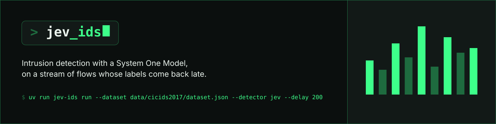

# JevIDS

   

**JevIDS detects zero-day attacks in a stream of network flows whose labels come back late. For each flow it shows [TypeSafe's Jev](https://docs.typesafe.ai/introduction) labeled flows it has already seen, from 1 to 8 per category, asks whether the flow under test is an attack, and joins that answer with a nearest-neighbour vote.**

An intrusion detection system (IDS) watches the traffic of a network and raises an alarm when it suspects an attack. JevIDS was tested on two public datasets, CIC-IDS2017 and TRUSTLab, with each label coming back 200 flows after its flow was judged. Its ROC-AUC on the zero-day flows was the highest of the detectors tested, 0.994 to 0.995 on CIC-IDS2017 and 0.930 to 0.933 on TRUSTLab. At an alarm cut calibrated before the test, its F1 on those flows was 0.937 to 0.946 on CIC-IDS2017, where a Random Forest reached 0.365, and 0.837 to 0.840 on TRUSTLab, where the Random Forest reached 0.833. Claude Sonnet 5.5 reached 0.932 to 0.939 and 0.706 to 0.726, at 62 and 39 to 40 times Jev's cost.

[Design](docs/jevids-design.md) · [Glossary](CONTEXT.md) · [The loop](jev_ids/stream.py) · [The fusion](jev_ids/fusion.py)

## The problem

A flow is the summary of one conversation between two computers, such as how many packets and bytes went each way, how long it lasted and which port it used. An IDS receives each flow and decides whether it is benign traffic or part of an attack.

Two facts make this hard. The system has never seen some attacks, the zero-day attacks, and a detector that learned from older attacks tends to take them for normal traffic. And the right answer arrives late, because an analyst confirms an attack only after someone investigates it. Until then the system keeps judging the next flows without knowing whether it got the earlier ones right.

> **Zero-day attack.** Here, a zero-day attack is a flow whose attack name never appears in the system's starting memory. A flow is at **first contact** when it is judged before any flow of its attack name has come back with its label. The results below count these flows.

The delay D is counted in flows. With D = 200, the label of a flow comes back after 200 more flows have been judged, which is longer than every zero-day burst in the CIC-IDS2017 test.

## How it works

JevIDS runs two detectors over the same stream and joins their answers.

**Jev alone.** Jev is an AI model from TypeSafe of a kind called a System One Model. It reads a block of text, the state, and answers typed questions about it with probabilities, so there is no generated text to parse. For each flow, JevIDS writes into the state the column names, a description of each category, k labeled flows per category (the examples) and the flow to judge. Jev answers `is_attack` with a probability, p_attack, and `category` with one category and a confidence. Three parts decide what Jev sees.

1. **The KController sets how many examples.** It keeps one number k per category, starting at 1. When the label of a flow comes back and Jev had named the wrong category, the k of the true category doubles, up to 8. When Jev was right, it falls by 1/k. This mirrors the rule TCP uses against congestion, reversed, because in an IDS showing too few examples costs more than showing too many.
2. **The Selector sets which examples.** Within each category it prefers flows close to the one under test, recent ones and ones Jev was unsure about, then skips near-duplicates by maximal marginal relevance. It always adds the benign flow nearest to the one under test.
3. **The compact record shortens the text.** Each decimal reaches Jev with 4 significant digits. Jev charges for the tokens it reads, so every character saved is money saved.

**The matched kNN.** It takes as many nearest flows of the memory as the Selector would show Jev at k = 4 and lets them vote. It calls no model and costs nothing.

**The fusion.** Each detector's p_attack becomes its percentile among the p_attack that detector gave on a separate development stream, and the full JevIDS takes the mean of the two. The two detectors catch different attacks. At the cut on TRUSTLab, the kNN caught all 87 C2Beaconing flows and Jev alone 68 to 71, while Jev alone caught 26 to 28 of the 81 DoS flows and the kNN none. When a call to Jev fails, the kNN's percentile stands alone.

The memory holds the labeled flows a step may draw examples from. These are the flows of the pool, prepared before the test, that ended before the flow under test, and every judged flow whose label has come back. Flows are judged in the order they end, because a real IDS receives a flow record only once the connection is over.

## How it was tested

### The data

| Dataset                                                                               | Captured          | Test split           | Benign | Zero-day at first contact, D = 200 | Zero-day attack names                                        |
| ------------------------------------------------------------------------------------- | ----------------- | -------------------- | ------ | ---------------------------------- | ------------------------------------------------------------ |
| CIC-IDS2017, relabelled by Liu et al. (IEEE CNS 2022)                                 | July 2017         | `paper`, 2,000 flows | 1,046  | 309                                | `SSH-Patator`, `DoS Slowhttptest`, `Infiltration - Portscan` |
| TRUSTLab, Cano Baños and Villafranca Albaladejo (Frontiers in Computer Science, 2026) | May and June 2025 | `paper`, 2,000 flows | 798    | 338                                | `C2Beaconing`, `DDoS`, `DoS`, `MITM`, `WebBased`             |

CIC-IDS2017 has six categories, benign traffic and five families. Its three zero-day attack names leave the pool while their categories keep other names, so Jev still sees examples of DoS, BruteForce and PortScan. TRUSTLab has sixteen categories, benign traffic and fifteen families, and its five zero-day families leave the pool whole, so they have no example until their first labels come back. Its traffic is scripted in a lab, and each family was captured on its own.

Each attack name's flows of each day were sorted in time and cut in half. The earlier half feeds the pool and the later half the test, so an example never comes from the future of a judged flow. A random draw with a fixed seed chose TRUSTLab's zero-day families before any run.

### The detectors compared

- **Random Forest** learns from labeled examples of every category.
- **Isolation Forest** learns only benign traffic and flags what departs from it, so it needs no attack example.
- **kNN** lets the 4 nearest flows of the memory vote, and the matched kNN lets as many vote as Jev reads.
- **Claude Sonnet 5.5**, a large language model, judges each flow from examples chosen by the same Selector and KController (`--detector llm:sonnet`). It ran with seeds 0, 1 and 2 and is read at the same cut as every other detector.

Each baseline is refitted at every step on the same memory JevIDS sees, so at each judgement it knows exactly what JevIDS knows. That is the forests' best case, since a refit takes up to 17.5 s.

### How the results are read

The primary metric is each detector's ROC-AUC on the test stream, and the PR-AUC is the secondary one. Neither needs a cut. The alarm cut of each dataset was calibrated before the test on a separate development stream, as the cut with the highest F1 for the fused score of the full JevIDS, and every detector is read at it, 0.2608 on CIC-IDS2017 and 0.377 on TRUSTLab. At that cut the tables give the F1 on the zero-day flows at first contact, the zero-day flows caught and the false alarms among the benign test flows. A stratified bootstrap in blocks of 25 flows, with 2,000 replicates, gives the 95 % interval of each F1, each ROC-AUC, each PR-AUC and each difference between two detectors on the same flows. McNemar's exact test compares the zero-day flows two detectors catch. Jev alone, the full JevIDS and Claude Sonnet 5.5 ran with three seeds, the deterministic baselines once.

### What each metric measures

Every detector gives each test flow an attack score between 0 and 1. Unless a line says otherwise, a metric counts the zero-day flows at first contact as positives and the benign flows as negatives. At D = 200 they are n = 309 and 1,046 flows on CIC-IDS2017 and n = 338 and 798 on TRUSTLab. Known attacks and zero-day flows that arrive after their family's first label are left out, because the detector already has examples of them. Below, P is the number of zero-day flows caught at the cut and A the number of false alarms.

- ROC-AUC (primary). The share of (zero-day, benign) pairs in which the zero-day flow scores above the benign one, a tie counting as half a pair. It ranges from 0 to 1, a random score gives 0.5, and 1 means every zero-day flow scores above every benign one. It uses the order of the scores alone, so it compares detectors whose scores live on different scales, and it measures each class apart, so it does not move with the share of zero-day flows and compares the two datasets and the three delays.
- PR-AUC (secondary). The average precision. For each zero-day flow it takes the share of zero-day flows among the flows scored at or above it, then averages those shares over the n zero-day flows. It ranges from 0 to 1, and a random score gives the share of zero-day flows among the counted flows, 0.228 on CIC-IDS2017 and 0.298 on TRUSTLab at D = 200. It weighs each false alarm by how much it dilutes the precision, the share of alarms that are real attacks, which is what an analyst answering the alarms sees. The precision-recall curve tells more than the ROC curve when positives are few ([Saito and Rehmsmeier, 2015](https://doi.org/10.1371/journal.pone.0118432)). The two can rank detectors differently. On CIC-IDS2017 the Isolation Forest has a higher ROC-AUC than the Random Forest, 0.871 against 0.836, and a lower PR-AUC, 0.517 against 0.732, because it puts many benign flows among the top-scored ones. It stays secondary because its random floor moves with the dataset and with D, so it compares detectors within one dataset and one delay only.
- F1 on zero-day flows (primary at the cut). 2P / (2P + A + (n − P)), the harmonic mean of the precision P / (P + A) and the recall P / n. A network must decide flow by flow whether to raise an alarm, and the cut is that decision. The F1 joins the two errors that matter at first contact, the missed zero-day flow and the false alarm, and leaves out the benign flows let through. The cut rule used the F1 before the test, so an F2 or another weighting was not swapped in after the results. The cut was calibrated on the full JevIDS's scores, so the report also shows every detector at every cut.
- Zero-day flows caught and false alarms. P with the recall P / n, and A with its share of the benign flows. With them a reader can rebuild the F1 or any other mix of the two errors.
- Known recall and overall F1. The recall on attacks whose families were already in the initial memory, and the F1 over all 2,000 flows with every attack as positive. They show whether a detector trades the attacks it knew for the zero-day ones.
- Bootstrap interval. Each replicate redraws the zero-day and the benign flows of a run in circular blocks of 25 consecutive flows, so it keeps n zero-day flows and the same number of benign ones. The blocks exist because flows judged close together see almost the same memory. The metric is recomputed on 2,000 replicates at the same cut, and the 95 % interval runs from the 2.5th to the 97.5th percentile. A fixed seed gives every run of one dataset and delay the same replicates, so a difference between two detectors is computed replicate by replicate. The interval covers which flows are in the stream, and it leaves out the spread across seeds and the choice of the cut.
- McNemar's exact test. For two detectors on the same flows, it counts the zero-day flows only the first catches and those only the second catches, and a two-sided exact binomial test gives the p value. It ignores false alarms, so each comparison also carries the paired bootstrap of the F1, the ROC-AUC and the PR-AUC. The p values have no correction for multiple comparisons.

The report asks four questions, and each has metrics that answer it. Zero-day flows caught, the F1, the ROC-AUC and the PR-AUC say whether JevIDS catches attacks it never saw at first contact, with and without a cut. False alarms, the F1 and the PR-AUC give the cost of those catches in alarms. Known recall and overall F1 say whether known attacks are still caught. The bootstrap, McNemar's test and the three seeds say whether a difference between detectors is real. The report also splits the zero-day flows by family and gives cost and latency. Accuracy is left out because it counts the benign flows let through and mixes known and zero-day attacks.

## Results

Zero-day flows at first contact at D = 200, each detector read at its dataset's cut. Three numbers are seeds 0 / 1 / 2.

| Dataset                                  | Detector         | ROC-AUC               | PR-AUC                | F1 on zero-day flows  | Zero-day flows caught | False alarms    |
| ---------------------------------------- | ---------------- | --------------------- | --------------------- | --------------------- | --------------------- | --------------- |
| CIC-IDS2017 (309 zero-day, 1,046 benign) | Full JevIDS      | 0.995 / 0.995 / 0.994 | 0.976 / 0.978 / 0.975 | 0.946 / 0.943 / 0.937 | 291 / 289 / 288       | 15 / 15 / 18    |
|                                          | Jev alone        | 0.994 / 0.994 / 0.993 | 0.969 / 0.970 / 0.964 | 0.836 / 0.833 / 0.827 | 309 / 309 / 309       | 121 / 124 / 129 |
|                                          | Random Forest    | 0.836                 | 0.732                 | 0.365                 | 69                    | 0               |
|                                          | Matched kNN      | 0.648                 | 0.457                 | 0.434                 | 86                    | 1               |
|                                          | kNN, K = 4       | 0.626                 | 0.423                 | 0.399                 | 77                    | 0               |
|                                          | Isolation Forest | 0.871                 | 0.517                 | 0.371                 | 309                   | 1,046           |
|                                          | Sonnet 5.5       | 0.978 / 0.982 / 0.991 | 0.971 / 0.980 / 0.980 | 0.932 / 0.935 / 0.939 | 274 / 274 / 278       | 5 / 3 / 5       |
| TRUSTLab (338 zero-day, 798 benign)      | Full JevIDS      | 0.930 / 0.933 / 0.932 | 0.908 / 0.911 / 0.909 | 0.838 / 0.840 / 0.837 | 264 / 266 / 265       | 28 / 29 / 30    |
|                                          | Jev alone        | 0.925 / 0.925 / 0.924 | 0.861 / 0.855 / 0.854 | 0.785 / 0.776 / 0.780 | 263 / 258 / 257       | 69 / 69 / 64    |
|                                          | Random Forest    | 0.867                 | 0.796                 | 0.833                 | 256                   | 21              |
|                                          | Matched kNN      | 0.860                 | 0.818                 | 0.801                 | 254                   | 42              |
|                                          | kNN, K = 4       | 0.856                 | 0.773                 | 0.788                 | 246                   | 40              |
|                                          | Isolation Forest | 0.697                 | 0.414                 | 0.539                 | 320                   | 529             |
|                                          | Sonnet 5.5       | 0.872 / 0.883 / 0.879 | 0.797 / 0.803 / 0.793 | 0.706 / 0.726 / 0.709 | 192 / 200 / 197       | 14 / 13 / 21    |

The full JevIDS has the highest ROC-AUC on both datasets. Its PR-AUC is the highest on TRUSTLab, 0.908 to 0.911 against 0.818 for the matched kNN and 0.796 for the Random Forest, and on CIC-IDS2017 it ties with Sonnet's, with the interval of the difference containing 0 in every seed. On CIC-IDS2017 Jev alone ranks the flows almost as well, yet at the cut it flags every zero-day flow along with 121 to 129 benign ones, and the full JevIDS catches 288 to 291 with 15 to 18 false alarms. On TRUSTLab the full JevIDS and the Random Forest reach a similar F1, and the interval of the difference contains 0 in every seed. The full JevIDS's ROC-AUC lies above the Random Forest's in every seed, and McNemar's exact test finds it catching more zero-day flows in every seed (10 to 2 discordant flows in seed 0, p = 0.039). The three seeds judge the same flows, so they are not independent evidence.

Each part of Jev was also removed in turn, and the Selector matters most. Without it, in seed 0, the full JevIDS's ROC-AUC falls from 0.995 to 0.951 on CIC-IDS2017 and from 0.930 to 0.875 on TRUSTLab, its PR-AUC from 0.976 to 0.844 and from 0.908 to 0.836, and its false alarms at the cut rise from 15 to 188 and from 28 to 223.

On CIC-IDS2017 Jev read about 3,000 tokens per flow, so a run of 2,000 flows cost 0.25 USD at TypeSafe's list price (127 USD per million flows), with a median call of 0.23 s. On TRUSTLab, with sixteen categories, it read about 15,500 tokens per flow, 1.30 to 1.32 USD per run, with a median call of 0.29 to 0.30 s. The matched kNN adds a median of 6 ms and 11 ms.

Claude Sonnet 5.5 ties the full JevIDS on CIC-IDS2017 and falls behind it on TRUSTLab, at 39 to 62 times the cost. On CIC-IDS2017 the interval of the F1 difference contains 0 in every seed. On TRUSTLab the full JevIDS leads in F1, in ROC-AUC and in PR-AUC in every seed. Jev alone, with its many false alarms on CIC-IDS2017, falls behind Sonnet in F1 there in every seed. Sonnet's median call took 1.82 to 1.92 s. A run of 2,000 flows cost 15.76 to 15.82 USD with Sonnet on CIC-IDS2017 and 51.88 to 52.27 USD on TRUSTLab, 62 and 39 to 40 times what Jev cost. Sonnet also refused 9 to 16 calls per run on CIC-IDS2017 and 72 to 79 on TRUSTLab as cyber content, all but three of them on attack flows.

### Limits worth knowing

- On TRUSTLab, 144 to 155 calls per seed failed near the end of the stream, because ten categories had reached k = 8 and the request outgrew TypeSafe's input limit. None of them fell on a zero-day flow at first contact, and the full JevIDS falls back on the kNN for them.
- The F1 peak on CIC-IDS2017 is narrow. In seed 0 the full JevIDS's F1 is 0.848 at a cut of 0.25, 0.946 at 0.2608 and 0.877 at 0.27, so the F1 depends on a cut taken from another stream.
- Every label comes back, missed attacks included. A real security team confirms only some.
- Jev's cost is TypeSafe's list price, not what was billed.

## Try it

```bash
git clone https://github.com/jev-sec/jev-ids.git
cd jev-ids
uv sync
# .env holds TYPESAFE_API_KEY for Jev and ANTHROPIC_API_KEY for the Sonnet 5.5 baseline.
```

Download `CICIDS2017_improved.zip` from the [relabelled version of Liu et al.](https://intrusion-detection.distrinet-research.be/CNS2022/Dataset_Download.html) into `data/raw/cicids2017/`, or the [TRUSTLab files](https://doi.org/10.82432/10317/21203), and prepare them once. The test splits are committed, so only the pool needs the raw data.

```bash
uv run python -m scripts.prepare_cicids2017
uv run python -m scripts.prepare_trustlab --raw <folder holding the 16 *.csv.gz>
uv run jev-ids run --dataset data/cicids2017/dataset.json --detector jev --split paper --delay 200 --k 1 --control aimd --selection score+nearest --seeds 0
```

A run writes `results/<timestamp>-<dataset>-<detector>-<split>/` with `config.json`, one JSON row per flow in `predictions.jsonl` (verdict, truth, p_attack, category, confidence, the k of every category, latency and tokens) and Jev's raw answers in `responses.jsonl`. A failed call becomes a row with `error`, counted as no alarm.

## Reproduce the paper

Every number and figure of the paper comes from [`results/paper/numbers.json`](results/paper/numbers.json). It holds one entry per dataset, `cicids2017` and `trustlab`, with these keys.

| Key               | What it holds                                                                                                                                                                                                                                                                                                                                                                      |
| ----------------- | ---------------------------------------------------------------------------------------------------------------------------------------------------------------------------------------------------------------------------------------------------------------------------------------------------------------------------------------------------------------------------------- |
| `cut`, `cut_rule` | The cut on p_attack that every detector shares, and the mean F1 of the validation runs at that cut and at 0.5                                                                                                                                                                                                                                                                      |
| `lines`           | One entry per detector. Jev alone is `jev/<variant>-d<D>-s<seed>`, the full JevIDS `fusion/<variant>-d<D>-s<seed>`, each baseline `<baseline>/d<D>` and Sonnet 5.5 `sonnet/d200-s<seed>`. Each entry gives the F1, ROC-AUC and PR-AUC with their 95% intervals, the counts at the cut, F1 over a sweep of cuts and the cost. `run` names the directory of the run it was read from |
| `tests`           | McNemar's exact test and the bootstrap interval of each difference, one entry per pair of detectors                                                                                                                                                                                                                                                                                |
| `calibration`     | The runs over the development stream that set the cut and the percentiles of the fusion                                                                                                                                                                                                                                                                                            |
| `bursts`          | The stream positions of each attack name, its category and how many of its flows arrive at first contact                                                                                                                                                                                                                                                                           |

The runs themselves stay out of the repository. To produce them again, `DATASET` picks `cicids2017` or `trustlab`. A finished run with no failed call leaves a stamp in `results/zeroday-<dataset>/v2-done/`, so `make -k` runs again only what is missing.

```bash
make zeroday-cut DATASET=cicids2017        # Jev alone over the development stream, for its cut (paid)
make zeroday-knn-cut DATASET=cicids2017    # the matched kNN over the same stream, for the fusion
make -k zeroday-baselines DATASET=cicids2017
make -k zeroday-jev DATASET=cicids2017     # Jev alone and its ablations, 17 paid runs here and 13 on TRUSTLab
make -k zeroday-sonnet DATASET=cicids2017  # Sonnet 5.5, 3 paid runs
make paper-numbers                         # fuses, measures and compares the runs of both datasets
```

On TRUSTLab six Jev runs keep failed calls from Jev's token limit, the full JevIDS at every D and seed and the run without the Selector, so make withholds their stamps. The paper reads them as they are, so write the directory name of each one into its stamp, as in `echo <run directory> > results/zeroday-trustlab/v2-done/full-d50-s0`. `uv run jev-ids metrics <runs>` and `uv run jev-ids compare --a <run> --b <run>` read single runs. [`docs/jevids-design.md`](docs/jevids-design.md) gives every decision, the values fixed before the runs and the full battery.

## The code

| File                                   | Job                                                                                                                                                        |
| -------------------------------------- | ---------------------------------------------------------------------------------------------------------------------------------------------------------- |
| [cli.py](jev_ids/cli.py)               | `run`, `redo-errors`, `metrics`, `compare`, `threshold` and `fuse`                                                                                         |
| [dataset.py](jev_ids/dataset.py)       | The card, the pool, the splits and the compact record                                                                                                      |
| [stream.py](jev_ids/stream.py)         | The stream, the memory and the labels that come back D flows late                                                                                          |
| [controller.py](jev_ids/controller.py) | The KController                                                                                                                                            |
| [selector.py](jev_ids/selector.py)     | The Selector                                                                                                                                               |
| [fusion.py](jev_ids/fusion.py)         | The full JevIDS, from a run of Jev and a run of the matched kNN                                                                                            |
| [run.py](jev_ids/run.py)               | The loop and the three files of a run                                                                                                                      |
| [records.py](jev_ids/records.py)       | One prediction row                                                                                                                                         |
| [metrics.py](jev_ids/metrics.py)       | Recall at a false alarm rate, F1, cost, latency and the paired tests                                                                                       |
| [detectors/](jev_ids/detectors)        | Jev, the Sonnet 5.5 baseline, the Random Forest, the kNN and the Isolation Forest                                                                          |
| [prompts/](prompts)                    | Per dataset, `jev.json`, the whole request to Jev, and `llm.md`, the instructions of the Sonnet 5.5 baseline                                               |
| [scripts/](scripts)                    | `prepare_<dataset>.py`, `draw_split.py` for the test splits, `draw_dev.py` for the development streams and `paper_numbers.py` for the numbers of the paper |

## Development

```bash
make check
```

Python 3.13+. The gate runs ruff, complexipy, pyright in strict mode, pytest with coverage, vulture, import-linter, pip-audit and jscpd, and `make list` shows each check. Runs make paid API calls and write only under `results/`.

## Bring your own flows

JevIDS is an independent research prototype and is independent of TypeSafe. To try it on your own traffic:

1. Set `TYPESAFE_API_KEY` in `.env`. Pricing and terms are TypeSafe's.
2. Write a dataset card like [`data/cicids2017/dataset.json`](data/cicids2017/dataset.json), with your flow exporter's columns in order, which are symbolic, your categories and which is benign.
3. Copy [`prompts/cicids2017/jev.json`](prompts/cicids2017/jev.json) and replace the columns and the category descriptions with yours.
4. Seed the memory with at least one labeled flow per category.
5. Run `jev-ids run --delay` and `jev-ids metrics` on a labeled split of your own flows before trusting any number, because the numbers above belong to these two datasets.

Only flow features leave your network, never payloads, but every request does go to TypeSafe's API.

## Team

<table align="center">
  <tr>
    <td align="center" width="220">
      <a href="https://github.com/paulosevero"></a><br />
      <b>Paulo Severo</b><br />
      <a href="https://github.com/paulosevero"><code>@paulosevero</code></a>
    </td>
    <td align="center" width="220">
      <a href="https://github.com/sequincozes"></a><br />
      <b>Silvio Quincozes</b><br />
      <a href="https://github.com/sequincozes"><code>@sequincozes</code></a>
    </td>
    <td align="center" width="220">
      <a href="https://github.com/amandadiasdev"></a><br />
      <b>Amanda Dias</b><br />
      <a href="https://github.com/amandadiasdev"><code>@amandadiasdev</code></a>
    </td>
  </tr>
</table>

---

[TypeSafe docs](https://docs.typesafe.ai/introduction) · [Jev models and pricing](https://docs.typesafe.ai/models) · [CIC-IDS2017, relabelled](https://intrusion-detection.distrinet-research.be/CNS2022/Dataset_Download.html) · [TRUSTLab data](https://doi.org/10.82432/10317/21203) · [Glossary](CONTEXT.md)
